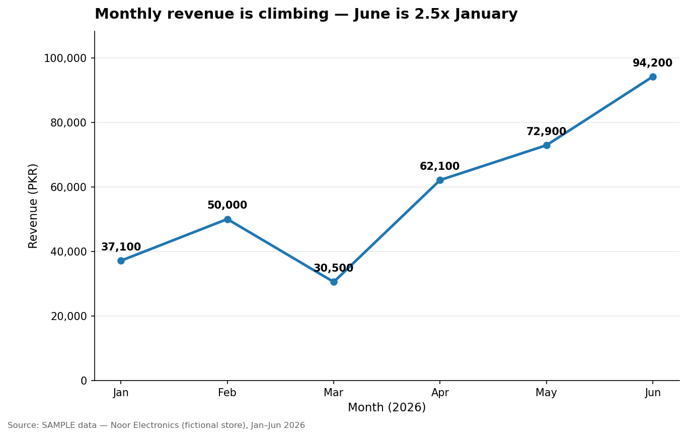
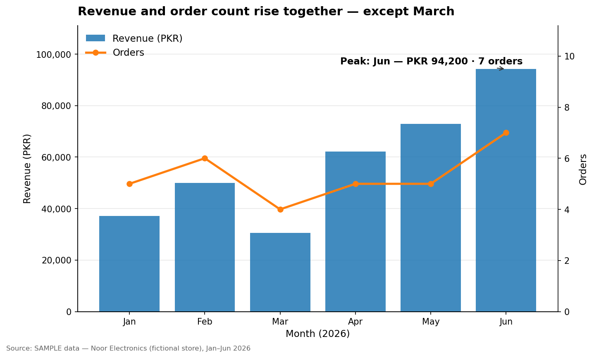

# Mini #23 — Python Data Visualisation Pack (matplotlib + seaborn)

**Status:** built, verified locally — publish pending

**SAMPLE / DEMO data only.** Fictional store, fictional sales,
fictional numbers. Never claimed as real client work.

The visualisation companion to Mini #19's groupby pack and Mini
#22's joins pack: the same "Noor Electronics" shop as Mini #1 /
#3 — 32 clean orders, 52 clean lines, PKR 346,800, Jan–Jun 2026 —
now drawn ten ways. Ten chart types, one per technique, each
answering a question a working analyst asks every week: is it
rising, what leads, how is it spread, what moves with what — and
which chart do I reach for? Every number is recomputed
independently from the raw CSVs by `src/checks.py`, and every chart
ships with the CSV of its exact plotted values, so anyone can
re-plot it and get the same picture. This pack is the skill base
for Flagship 3 (Sales Forecasting, due 18 Dec 2026), whose
dashboard is charts all the way down.

## Business question

"Which chart answers this question — and can I trust the picture?"

## What is inside

| File | What it does |
|---|---|
| `outputs/findings.md` | The teaching write-up: headline numbers + what each chart shows, when to use it, one common mistake per technique |
| `outputs/summary.json` | Every verified headline number, machine-readable |
| `outputs/technique_01_monthly_revenue.png` | Technique 1 — line chart, monthly revenue trend |
| `outputs/technique_01_monthly_revenue.csv` | Technique 1 data — revenue, orders, AOV by month |
| `outputs/technique_02_revenue_by_category.png` | Technique 2 — bar chart, revenue by category |
| `outputs/technique_02_revenue_by_category.csv` | Technique 2 data — revenue, lines, share by category |
| `outputs/technique_03_category_by_month.png` | Technique 3 — grouped bar, category × month |
| `outputs/technique_03_category_by_month.csv` | Technique 3 data — revenue by month × category |
| `outputs/technique_04_order_value_histogram.png` | Technique 4 — histogram, order-value distribution |
| `outputs/technique_04_order_value_histogram.csv` | Technique 4 data — PKR 5,000 bins and order counts |
| `outputs/technique_05_line_revenue_by_category.png` | Technique 5 — box plot, line revenue by category |
| `outputs/technique_05_line_revenue_by_category.csv` | Technique 5 data — all 52 line revenues by category |
| `outputs/technique_06_quantity_vs_revenue.png` | Technique 6 — scatter, quantity vs revenue by category |
| `outputs/technique_06_quantity_vs_revenue.csv` | Technique 6 data — all 52 lines with quantity and revenue |
| `outputs/technique_07_category_month_heatmap.png` | Technique 7 — heatmap, category × month revenue |
| `outputs/technique_07_category_month_heatmap.csv` | Technique 7 data — the 6 × 4 revenue matrix |
| `outputs/technique_08_june_daily_traffic.png` | Technique 8 — seaborn pairplot, June daily traffic |
| `outputs/technique_08_june_daily_traffic.csv` | Technique 8 data — 30 June days of traffic + orders |
| `outputs/technique_09_revenue_and_orders.png` | Technique 9 — dual-axis, revenue + order count, peak annotated |
| `outputs/technique_09_revenue_and_orders.csv` | Technique 9 data — revenue, orders, share by month |
| `outputs/technique_10_monthly_trend_per_category.png` | Technique 10 — small multiples, monthly trend per category |
| `outputs/technique_10_monthly_trend_per_category.csv` | Technique 10 data — monthly revenue + share per category |
| `data/raw/orders_SAMPLE.csv` | 32 clean orders, Jan–Jun 2026 |
| `data/raw/order_items_SAMPLE.csv` | 52 clean order lines |
| `data/raw/products_SAMPLE.csv` | 9 products, 4 categories (clean catalogue) |
| `data/raw/daily_traffic_SAMPLE.csv` | 30 June days: sessions, visitors, ad spend, orders |
| `data/README.md` | Data dictionary + how the totals reconcile |
| `src/generate_data.py` | Regenerates all SAMPLE CSVs (deterministic, no randomness) |
| `src/build_charts.py` | The 10 techniques + summary.json + findings.md |
| `src/checks.py` | Checks as code — every number re-derived from the raw CSVs |
| `src/run_tests.py` | Test runner — runs checks.py, prints PASS/FAIL |
| `requirements.txt` | pandas + matplotlib + seaborn + numpy |

## Key numbers (real numbers, recomputed from the CSVs)

| KPI | Value |
|---|---|
| Clean orders / clean lines | 32 / 52 (Jan–Jun 2026) |
| Clean revenue | PKR 346,800 |
| Units sold | 81 |
| Monthly revenue | Jan 37,100 · Feb 50,000 · Mar 30,500 · Apr 62,100 · May 72,900 · Jun 94,200 |
| Peak month | 2026-06 — PKR 94,200 (7 orders, 27.16% of total) |
| Lowest month | 2026-03 — PKR 30,500 |
| Jan → Jun growth | +153.91% |
| MoM growth | Feb +34.77% · Mar -39.00% · Apr +103.61% · May +17.39% · Jun +29.22% |
| Revenue by category | Kitchen PKR 106,000 · Furniture PKR 105,600 · Electronics PKR 104,000 · Stationery PKR 31,200 |
| Category shares | Kitchen 30.57% · Furniture 30.45% · Electronics 29.99% · Stationery 9.00% |
| Zero-revenue cells | 2 — Jan Furniture, Feb Stationery |
| Order value: mean / median | PKR 10,837.50 / PKR 10,250 |
| Order value: min / max | PKR 2,400 / PKR 20,400 |
| Orders PKR 5,000–15,000 | 20 of 32 (62.50%) |
| Histogram bins (PKR 5,000) | 5 · 11 · 9 · 5 · 2 |
| Box medians (line revenue) | Electronics PKR 5,000 · Furniture PKR 8,400 · Kitchen PKR 6,400 · Stationery PKR 3,600 |
| Quantity vs revenue | Pearson r = -0.151 (price, not volume, decides a line) |
| Hottest heatmap cell | 2026-06 Kitchen — PKR 43,500 |
| Coldest non-zero cell | 2026-01 Kitchen — PKR 3,200 |
| Per-category peak month | Electronics May PKR 36,500 · Furniture Apr PKR 36,000 · Kitchen Jun PKR 43,500 · Stationery Jan PKR 14,400 |
| June traffic | 7,649 sessions · 2,382 visitors · PKR 45,600 ad spend · 7 orders |
| June conversion | 0.092% of sessions |
| Traffic correlations | sessions–visitors r = 0.995 · sessions–ad spend r = 0.997 |
| Checks | see `python3 src/checks.py` |

## The 10 techniques

| # | Technique | Tool | What it answers |
|---|---|---|---|
| 1 | Line chart | matplotlib | Is revenue rising, falling, or flat over time? |
| 2 | Bar chart | matplotlib | Which category brings in the most? |
| 3 | Grouped bar | matplotlib | Which category leads in which month? |
| 4 | Histogram | matplotlib | Where does the typical order value sit? |
| 5 | Box plot | matplotlib | How wide is each category's spread — and what is extreme? |
| 6 | Scatter (hue) | matplotlib | Does buying more units mean a bigger line? |
| 7 | Heatmap | seaborn | Where is the hot spot in the month × category table? |
| 8 | Pairplot (KDE) | seaborn | How do sessions, visitors and ad spend move together? |
| 9 | Dual-axis + annotation | matplotlib | Do revenue and order count rise together — and where is the peak? |
| 10 | Small multiples | matplotlib | Same trend, four categories — whose shape is different? |

## What the pack teaches

1. **Pick the chart by the question, not by habit.** Trend →
   line, comparison → bar, two dimensions → grouped bar or
   heatmap, shape → histogram, spread → box, relationship →
   scatter, many variables → pairplot, two scales → dual-axis,
   same trend across groups → small multiples.
2. **A chart is only as honest as its axis.** Zero-based bars,
   labelled dual axes, one shared scale across panels, bins fixed
   before plotting — each technique names the lie it avoids.
3. **Every chart ships its data.** Each PNG has a matching CSV of
   the exact plotted values, so anyone can re-plot it and get the
   same picture. A chart without its data is a claim, not evidence.
4. **Small data still teaches real judgement.** 52 lines cannot
   prove a trend, but they show what a trend, a dip, a zero cell
   and a weak correlation each look like — and how to spot when a
   chart is dressing one up as the other.
5. **The numbers reconcile.** Monthly revenue sums to PKR 346,800,
   category revenue sums to PKR 346,800, order values sum to
   PKR 346,800, and the 7 June order days in the traffic file are
   the 7 June order dates. If a chart disagrees with the CSV, the
   chart is wrong.

## Verified numbers

| KPI | Value |
|---|---|
| Clean revenue | PKR 346,800 |
| Peak / lowest month | Jun PKR 94,200 / Mar PKR 30,500 |
| Jan → Jun growth | +153.91% |
| Top / smallest category | Kitchen PKR 106,000 / Stationery PKR 31,200 |
| Order value mean / median | PKR 10,837.50 / PKR 10,250 |
| Histogram bins | 5 · 11 · 9 · 5 · 2 |
| Quantity vs revenue r | -0.151 |
| Hottest / coldest cell | Jun Kitchen PKR 43,500 / Jan Kitchen PKR 3,200 |
| June traffic | 7,649 sessions, 0.092% conversion |
| Checks | see `python3 src/checks.py` |

Verification: `python3 src/checks.py` — every headline number is
recomputed from the raw CSVs with the standard library only (no
pandas) and compared against every output CSV, summary.json,
findings.md and this README; every chart PNG is checked to be a
real PNG of at least 800×500 px and over 10 KB; and the generator
re-run is byte-compared for determinism (see `src/checks.py`).

## How to run it

1. Install the dependencies: `pip install -r requirements.txt`.
2. Read `outputs/findings.md` — that is the deliverable.
3. To regenerate the sample data: `python3 src/generate_data.py`.
4. To re-run the analysis: `python3 src/build_charts.py`.
5. To check it: `python3 src/checks.py`.
6. Or run the test suite: `python3 src/run_tests.py`.
7. To practise on your own data: replace the raw CSVs (same
   columns) and re-run steps 4–6 only — do NOT re-run step 3, it
   regenerates the sample data and would overwrite your files.

## Two traps this pack teaches

- **A truncated axis lies with true numbers.** The same monthly
  revenue looks flat from zero and dramatic from PKR 30,000.
  Both charts use the true values; only one is honest. Start
  bars at zero, and say so when a line chart does not.
- **A chart without its data is a claim, not evidence.** The
  June peak looks like a triumph until the CSV shows it is 7
  orders, 27.16% of six months, on a base of 32 orders. Ship the
  CSV with the PNG, every time.

## Limits

- **SAMPLE data only.** The store, the sales and the "findings"
  are invented to teach the techniques. The matplotlib/seaborn
  patterns are real.
- **One shop, six months, 52 lines.** The patterns scale — the
  row counts do not. A histogram of 32 orders shows the shape of
  the bins, not a law of the market.
- **The traffic file is illustrative, not causal.** Sessions,
  visitors and ad spend move together (r ≈ 0.995–0.997) because
  they were written to move together; the pack uses them to teach
  pairplots, not to prove that ads cause orders.

## Published

Not published yet — built and verified locally 23 Nov 2026.
